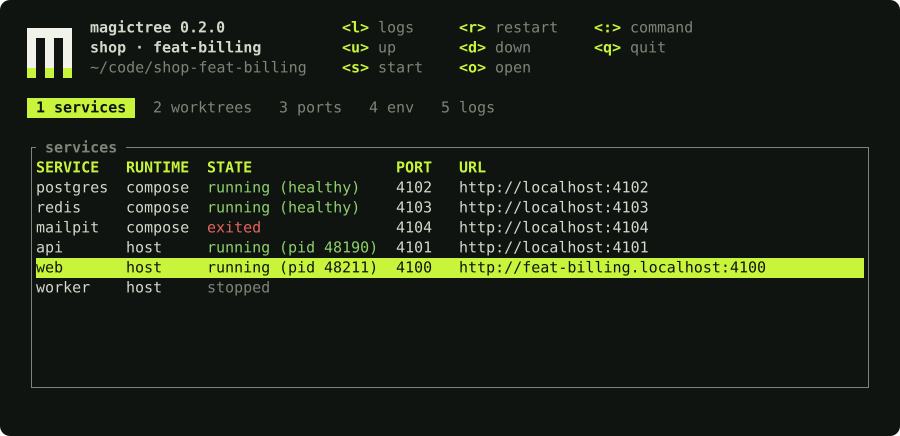

<p align="center">
  <picture>
    <source media="(prefers-color-scheme: dark)" srcset="docs/banner-dark.svg">
    
  </picture>
</p>

# magictree

Per-worktree development stacks. Every git worktree gets its own ports, environment,
bootstrap, and supervised processes, so several branches run side by side without colliding.

A worktree is the unit: the primary checkout and every linked worktree run a stack of their
own, with their own ports and their own state.

<p align="center">
  
</p>

`magictree` on its own opens this screen on the worktree it is run in; every key in it runs
one of the commands below.

## Quick start

Onboard once, in the primary checkout, and commit the manifest — a worktree inherits only
what git tracks:

```sh
magictree discover && magictree init     # read the repository, write magictree.toml
git add magictree.toml && git commit -m "add magictree.toml"
magictree up                             # allocate ports, bootstrap, start services, wait for health
```

Then every branch gets a stack of its own, on its own ports:

```sh
magictree new feat/billing               # a worktree beside the checkout, and its stack
magictree                                # the screen above, for the worktree you are in
magictree rm feat/billing                # stop it and remove it; the branch is kept
```

Nothing is configured per worktree and nothing is written into a checkout: ports, environment
and state live in magictree's own state directory, keyed by repository and worktree.

## The TUI

The screen is a row of sections — `services`, `worktrees`, `ports`, `env`, `logs` — switched
by a digit, `tab`, or `:` and the section's name. What changes a stack is a key, and each key
runs the command a shell would, with its output kept on screen:

| section | keys |
|---|---|
| `services` | `l` logs, `u` up, `s` start, `r` restart, `d` down, `o` open the URL |
| `worktrees` | `enter` open that worktree's stack, `x` remove it, `c` reclaim what gone ones left |
| `ports`, `env` | `u` up, `d` down |

`down`, `rm` and `gc` ask first, and under `magictree -n` every key is a dry run.
[More in the command reference](docs/commands.md#the-tui).

## Commands

| | |
|---|---|
| `discover`, `init`, `doctor` | read the repository, write manifests, detect drift |
| `up`, `down`, `restart`, `status` | start, stop, restart specific services, inspect a worktree's stack |
| *(no command)* | the TUI: every service's state, its log, ports and environment on one screen, with `up`, `restart`, `down` a key away |
| `logs`, `env`, `ports` | service output (one service, or `--all` for the whole stack, Compose included), resolved environment, port assignment |
| `exec` | run a command with this worktree's resolved environment |
| `activate` | keep a shell's own environment in step with the worktree it sits in |
| `new`, `rm`, `list`, `gc` | worktree lifecycle and resource reclamation |
| `completion` | a shell completion script, printed to stdout |
| `update` | install the latest release over this binary |

`--dry-run` (`-n`) works on every command and creates nothing: `magictree -n up`. Each
command's `--help` lists its flags.

## Documentation

| | |
|---|---|
| [Worktrees](docs/worktrees.md) | onboarding, creating and removing worktrees, port modes, browser aliases, image builds |
| [Commands](docs/commands.md) | the commands in detail, the TUI, `exec`, shell completion, shell activation, updating |
| [Manifest](docs/manifest.md) | everything `magictree.toml` can say: services, ports, health, bootstrap, jobs, monorepos |
| [Configuration](docs/configuration.md) | machine-wide settings, and where magictree keeps its state |

Two worked manifests live in the repository: [`examples/single-app`](examples/single-app/README.md)
and [`examples/monorepo`](examples/monorepo/README.md).

## Agents

`skills/magictree/SKILL.md` teaches a coding agent to operate the CLI. Onboarding belongs to
the primary checkout: `init` writes the manifest where it runs, so a manifest written inside a
linked worktree is untracked and no other worktree inherits the stack.

## Development

`cargo fmt --check` runs in the pre-commit hook, so a commit the formatter would rewrite never
lands. Git does not copy hooks from a clone, so point it at the tracked ones once:

```sh
git config core.hooksPath .githooks
```
